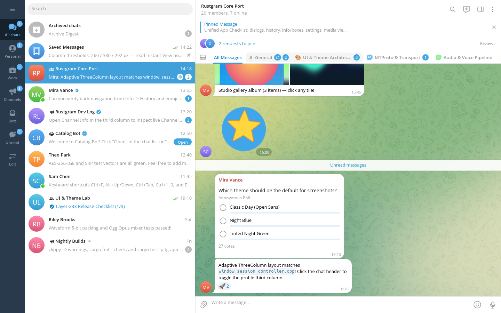
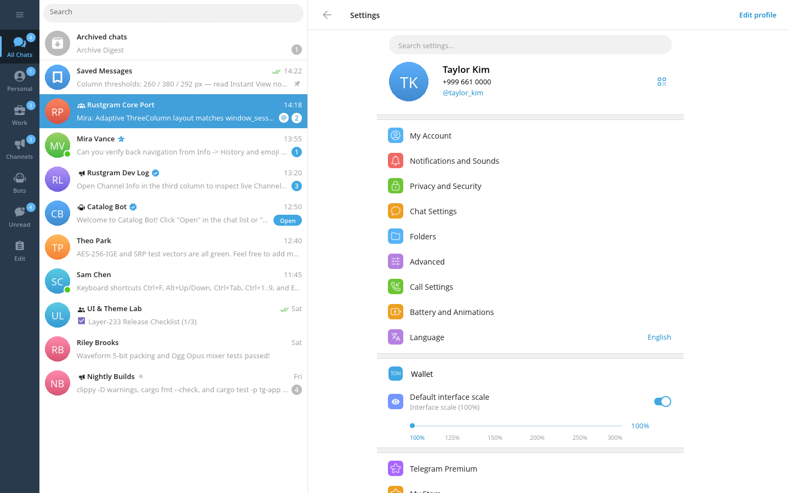
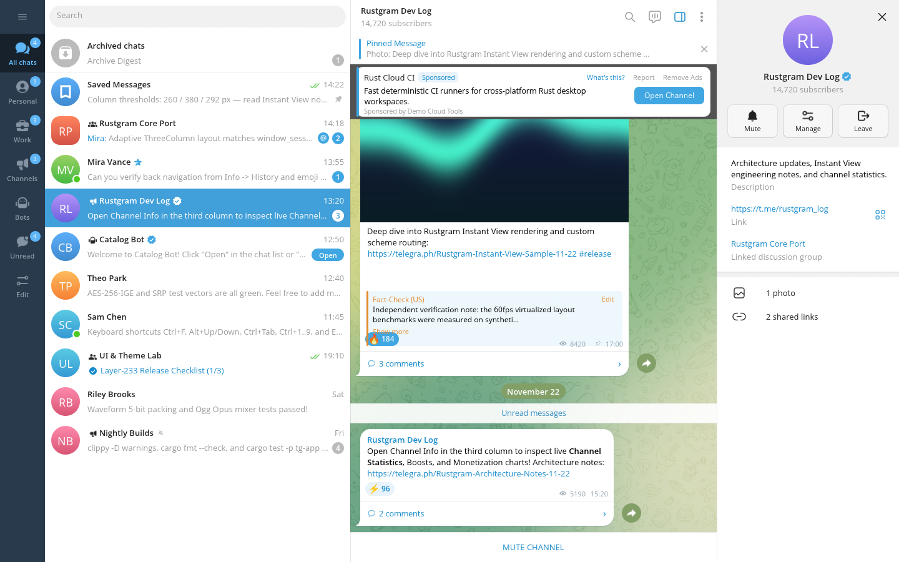
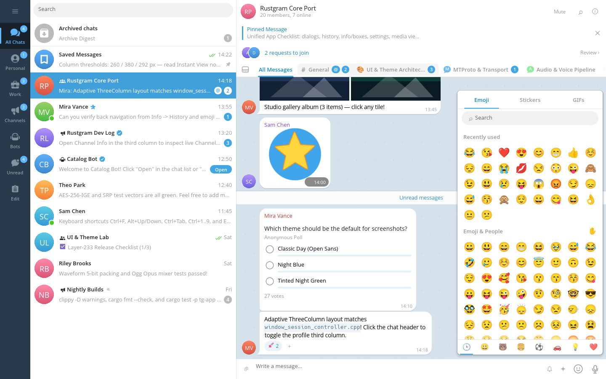

<div align="center">


# Rustgram

**A Telegram desktop client written entirely in Rust.**

From the MTProto protocol and its encryption up to every screen of the interface — no TDLib, no Qt, no C++.

[](LICENSE)


[](https://github.com/murmaider227/rustgram/actions/workflows/ci.yml)
[](https://codecov.io/gh/murmaider227/rustgram)



</div>

---

## What is Rustgram?

Rustgram is a full Telegram client for Windows, written from scratch in Rust as a faithful port of
[Telegram Desktop](https://github.com/telegramdesktop/tdesktop). To our knowledge it is the first
complete Telegram client in which **everything is Rust**: the MTProto 2.0 network protocol, the
cryptography, the update and sync engine, local storage and the entire user interface.

Other Rust Telegram apps wrap [TDLib](https://github.com/tdlib/td), Telegram's C++ library, and
only add a UI on top. Rustgram does not: it speaks the Telegram protocol itself, and its behaviour is
checked line by line against Telegram Desktop.

> **Status: pre-release.** Rustgram is under active development and not yet ready for daily use.
> Read [Project status](#project-status) before you try it with a real account.

[Code signing policy](#code-signing-policy) · [Privacy](docs/PRIVACY.md)

## Highlights

- **Pure Rust, top to bottom.** MTProto 2.0 with perfect forward secrecy, AES-IGE / AES-CTR,
  RSA and Diffie-Hellman key exchange, SRP two-step verification, obfuscated transports and
  MTProxy, all implemented in Rust.
- **A port, not a reimagining.** Every subsystem follows the matching Telegram Desktop source: the
  same requests, flags, paging, caching rules and update handling, so the client behaves like the
  official one.
- **Native interface.** Built with [egui](https://github.com/emilk/egui), with Telegram Desktop's
  sizes, colours, icons and animations ported from its style files. Day and night themes, custom
  themes and chat wallpapers.
- **Compatible local data.** Reads and writes Telegram Desktop's `tdata` format.
- **Tested against Telegram.** Over 2,000 tests, including protocol conformance suites that replay
  scripted MTProto sessions byte for byte, and live runs against Telegram's official test servers.
- **Fast and light.** Starts faster and uses less than half the memory of Telegram Desktop 7.4.6 in our
  measurements ([Performance](#performance)).
- **About a million lines of Rust** across some 1,200 source files.

## Features

| Area | Implemented |
|---|---|
| **Account** | Phone, code, QR and passkey login, two-step verification, multiple accounts, sessions, privacy, passcode lock |
| **Chats** | Folders, archive, pinning, unread counters, forum topics, Saved Messages, scheduled messages, drafts, search |
| **Messages** | Formatting, replies, forwards, edits, reactions, polls, read receipts, translation, AI summaries, rich messages |
| **Media** | Photos, videos, albums, files, voice and round video messages, stickers, animated emoji, GIFs, streaming playback |
| **Groups & channels** | Admin rights, permissions, invite links, join requests, admin log, statistics, boosts, stories |
| **Calls** | One-to-one and group voice/video calls, scheduled group calls, live streams |
| **Bots** | Keyboards, inline mode, Mini Apps, payments, Telegram Business features |
| **More** | Telegram Stars and gifts, Premium features, TON wallet, Instant View, data export, notifications, tray, auto-update |

Implemented means the code and its tests exist; most of it has not yet been used day to day on
Telegram's production servers.

## Performance

Rustgram 0.1.0-alpha.2 measured against Telegram Desktop 7.4.6 on 2026-11-26 on one Windows 11 PC
(Ryzen 7 9700X, 31 GiB RAM), both clients on Telegram's test servers with the same test account;
medians of 5 runs. Method, raw runs and what was not measured: [docs/BENCHMARKS.md](docs/BENCHMARKS.md).

| Metric | Telegram Desktop 7.4.6 | Rustgram |
|---|---:|---:|
| Start → first window | 771 ms | **368 ms** |
| Start → chat list ready | 1568 ms | **847 ms** |
| Open a chat → history ready | 217 ms | **38 ms** |
| Private memory after start | 311.3 MiB | **117.7 MiB** |
| Working set after start | 285.8 MiB | **140.5 MiB** |
| Start → first window, no account | 1232 ms* | **272 ms** |
| Idle private memory, no account | 288.1 MiB* | **92.8 MiB** |

\* Telegram Desktop's no-account numbers are from 2026-11-25 (same version): without an account it
connects to the production servers, which these test runs do not use.

The test account has two chats, so scrolling and memory with many chats were not measured against
Telegram Desktop yet.

## Project status

| | |
|---|---|
| **Feature parity** | about 94% of Telegram Desktop's features by our own code audit (an estimate, not a measurement) |
| **Platform** | Windows 10/11 x64; the platform layer is isolated so other systems can follow |
| **Tested on live servers** | QR login, sync, Saved Messages, groups, channels, file transfer and reconnects on Telegram's test servers, plus two-account messaging: live delivery, read receipts, typing, reactions and files |
| **Not done yet** | long-running use on production servers, signed release builds, macOS and Linux |

## Building

### Requirements

- Windows 10 or 11, x64
- [Rust](https://rustup.rs) stable (2024 edition) with the MSVC toolchain
- Visual Studio Build Tools (MSVC) and the Windows SDK
- [FFmpeg](https://ffmpeg.org) shared libraries for video and audio, with `FFMPEG_DIR` pointing at them

### Telegram API credentials

Every Telegram client needs its own API credentials. Get an `api_id` and `api_hash` at
[my.telegram.org](https://my.telegram.org) (see Telegram's
[guide](https://core.telegram.org/api/obtaining_api_id)) and provide them at build or run time:

```powershell
$env:RUSTGRAM_API_ID = "12345"
$env:RUSTGRAM_API_HASH = "0123456789abcdef0123456789abcdef"
```

### Build and run

```powershell
git clone https://github.com/murmaider227/rustgram.git
cd rustgram
cargo run --release -p tg-app
```

Run the tests:

```powershell
cargo test --workspace
```

To try the client without a real account, start it with `-testmode`: it then connects only to
Telegram's [test servers](https://core.telegram.org/api/auth#test-accounts).

## Architecture

The workspace is split into about 40 crates that mirror Telegram Desktop's own modules:

```
tg-tl-gen ─▶ tg-tl ─┐
tg-crypto ──────────┼─▶ tg-transport ─▶ tg-mtproto ─▶ tg-api ─▶ tg-session ─┐
tg-text ─▶ tg-data ─┘                                                       │
tg-storage ─▶ tg-core ─▶ tg-app-core ─▶ media · settings · info · live ─▶ history ─▶ window ─▶ tg-app
tg-theme · tg-style ─▶ tg-ui ──────┘
```

| Layer | Crates |
|---|---|
| Protocol | `tg-tl` (generated layer-233 schema), `tg-crypto`, `tg-transport`, `tg-mtproto` |
| Data & API | `tg-data`, `tg-api`, `tg-session`, `tg-storage`, `tg-core` |
| Features | `tg-calls`, `tg-voip`, `tg-media`, `tg-video`, `tg-audio`, `tg-lottie`, `tg-iv`, `tg-webview`, `tg-wallet`, `tg-payments`, `tg-stories`, `tg-export`, … |
| Interface | `tg-style`, `tg-theme`, `tg-ui`, and the `tg-app-*` crates |

More detail is in [docs/ARCHITECTURE.md](docs/ARCHITECTURE.md).

## Screenshots

<table>
  <tr>
    <td></td>
    <td></td>
  </tr>
  <tr>
    <td></td>
    <td></td>
  </tr>
</table>

All names and messages in the screenshots are sample data.

## Code signing policy

Release builds are made only by the [release workflow](.github/workflows/release.yml) on GitHub Actions from a
tagged commit of this repository and published as a draft that a maintainer reviews before release. Each release
lists the SHA-256 of every file in `SHA256SUMS.txt`. Pre-releases are not Authenticode-signed yet, so Windows
SmartScreen may warn when you run the installer. Update packages (`.tupdate`) are signed with the project's
Ed25519 update key, and Rustgram installs an update only after verifying that signature. Details:
[CODE_SIGNING.md](CODE_SIGNING.md).

Every release file also carries a GitHub build provenance attestation, which proves it was built by this
repository's release workflow from the tagged commit. Check a download with the GitHub CLI:

```sh
gh attestation verify rustgram-<version>-win-x64-portable.zip -R murmaider227/rustgram
```

The `.exe` and `.zip` files of each published release are scanned on VirusTotal; the report links are added to the
release notes.

## Privacy

Rustgram has no servers of its own and collects no analytics or telemetry. See the
[privacy policy](docs/PRIVACY.md).

## Contributing

Contributions are welcome. Please read [CONTRIBUTING.md](CONTRIBUTING.md) first. In short: port
behaviour from the matching Telegram Desktop source, keep `cargo fmt` and
`cargo clippy -- -D warnings` clean, and add tests. Network code is tested against fakes or the test
servers, never against real accounts.

To report a security issue, see [SECURITY.md](SECURITY.md).

## License

Rustgram is a port of Telegram Desktop and is licensed under the
[GNU General Public License v3.0 or later](LICENSE), with the OpenSSL exception, like Telegram
Desktop itself. See [LEGAL](LEGAL) for the full notice.

## Disclaimer

Rustgram is an independent, unofficial client. It is not affiliated with, endorsed by or connected to
Telegram FZ-LLC or Telegram Messenger Inc. "Telegram" is a trademark of its respective owner. Use of
the Telegram API is subject to the [Telegram API Terms of Service](https://core.telegram.org/api/terms).
